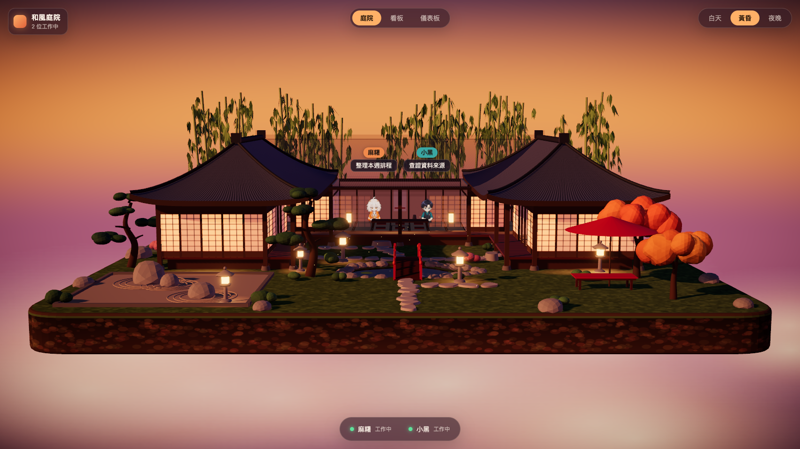
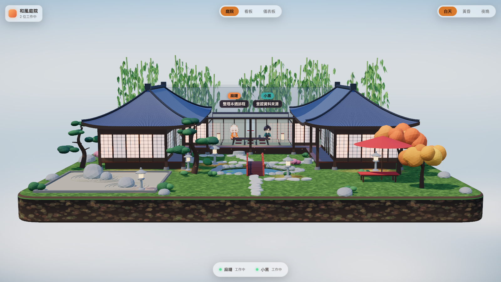
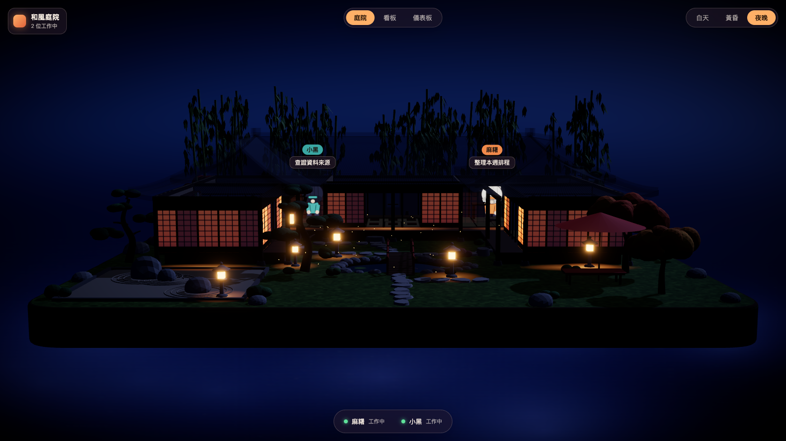
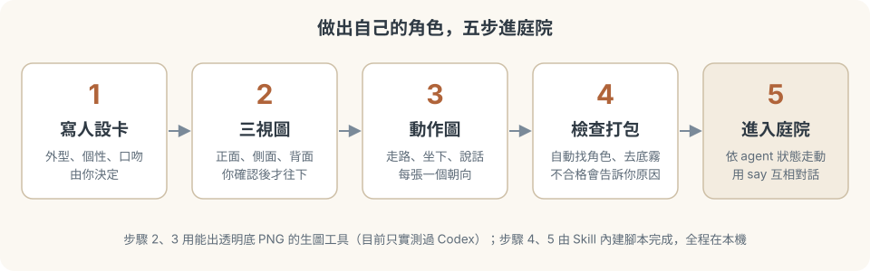

# agent-teahouse

**讓你的 AI 同事住進一座和風庭院。** 一個可以直接交給 AI agent 的 Skill：角色會依工作狀態走動、坐下的 3D Office，內含玻璃質感儀表板分頁。全部在你自己的電腦上跑，不需要帳號、不收集資料。

*An agent skill: a cozy 3D Japanese-courtyard office where your AI agents walk to their desks while working, with a glassy local-first dashboard tab. Runs entirely on your machine.*

<p>
  <a href="https://github.com/josenjc9/agent-teahouse/stargazers"></a>
  <a href="LICENSE"></a>
</p>

**[▶ 線上預覽（不用安裝，點開就能看）](https://josenjc9.github.io/agent-teahouse/)**

如果這個專案有幫到你，點右上角的 **⭐ Star**，讓更多人找得到。


*每一步由一行指令觸發：`set_state.py mochi working "整理本週排程"` 讓角色去工作，`set_state.py mochi say "…"` 讓角色開口說話。兩位範例角色為原創設計。*



| 白天 | 夜晚 | 儀表板 |
|---|---|---|
|  |  |  |

## 做出自己的角色


## 只想要儀表板？

儀表板另外有獨立的 repo：[teahouse-dashboard](https://github.com/josenjc9/teahouse-dashboard)，只有玻璃質感儀表板、沒有 3D。這個 repo 的 `teahouse-office/` 內含同一套儀表板分頁，兩邊資料格式相同。

## 不會用 GitHub？
1. 點頁面右上角的 **Code → Download ZIP**（不需要帳號、不需要 git），解壓縮。
2. 把解壓縮後的 `teahouse-office` 資料夾交給你的 AI agent：放進它的 skills 資料夾（各家路徑不同，請查你用的 agent 說明），或直接請它先讀該資料夾的 `SKILL.md`。
3. 對它說：**「幫我安裝並開起來」**，之後再說「幫我做我自己的角色」。

由 agent 替你執行安裝指令，你不必自己開終端機（這個流程尚未在各家真實 agent 上逐一驗證，見文末）。線上預覽只是展示，不能接你自己的 agent。

## 快速開始
```bash
git clone https://github.com/josenjc9/agent-teahouse.git
cd agent-teahouse/teahouse-office
./scripts/check_env.sh                 # 只檢查環境、不安裝任何東西
cd app && npm install && npm run dev   # 開 http://127.0.0.1:5180
```
另開終端機讓範例角色開始工作：
```bash
python3 scripts/set_state.py kuro working "查證資料來源"
```

## 交給 AI agent
把 `teahouse-office/` 整個資料夾放進你的 agent 的 skills 資料夾（路徑依各家 agent 而異），對它說「幫我做我的 Office」。`SKILL.md` 會帶 agent 一步步問你、做完、驗收。
Codex 或其他 agent：請它先讀該資料夾的 `SKILL.md` 再開始。

## 需要
Node.js 20.19+（或 22.12+）、Python 3.9+、瀏覽器。做角色圖另需 Pillow 與一個生圖工具。

## 安全
- 只在本機跑：開發伺服器只聽 `127.0.0.1`，不連外部服務、沒有追蹤。
- 不需要任何金鑰；自己接資料時，金鑰放環境變數。
- 分享前用 `scripts/scan_private.py` 檢查有沒有留下名字、路徑、金鑰。
- 詳見各資料夾的 `SECURITY.md`。發現安全問題請用 **Security → Report a vulnerability** 私下回報。

## 授權與素材
程式碼以 [MIT](LICENSE) 授權。兩位範例角色是原創設計，由 AI 生圖工具（OpenAI 圖像生成，經 Codex CLI）依 `teahouse-office` 自己的人設卡與提示詞流程製作（人設卡見 `teahouse-office/references/examples/`）；3D 場景的幾何與貼圖全部由程式產生。不含第三方美術素材。前端開源套件（React、three.js、react-three-fiber 等）各依其授權，由 npm 安裝時取得。

如果這個專案對你有用，歡迎給它一顆 ⭐，也歡迎開 issue 告訴我哪裡不好用。

## 目前還沒驗證
Codex 以外的生圖工具、真實 Claude Code／Codex 工作階段的完整接入、手機與 Safari／Windows。歡迎開 issue 回報。
